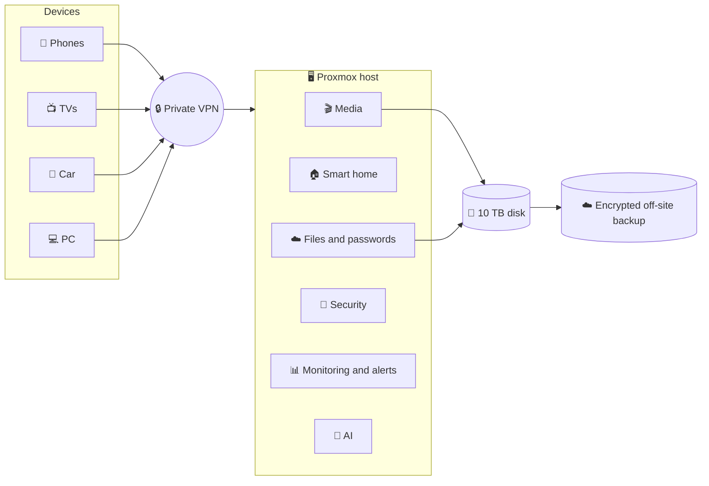
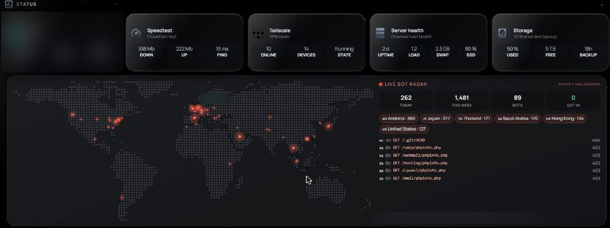

# 🏠 Homelab

**One small server at home that runs almost everything my family uses: movies, music, files, passwords, the smart home and the alerts that keep it all healthy.**

> This is a write-up of my setup, not a config dump. Addresses, names, keys and anything else private are left out on purpose.

## 🖥️ Hardware

| Part | Spec |
|---|---|
| Hypervisor | Proxmox VE 9 |
| CPU | AMD Ryzen 5 3600 (6 cores / 12 threads) |
| RAM | 32 GB |
| GPU | NVIDIA GTX 1660 Ti, shared by video transcoding and AI voice |
| Fast storage | SSD for the containers |
| Big storage | 10 TB disk for media, files and backups |
| Elsewhere | A Raspberry Pi 4 running the screen in my dad's grocery store ([smart-store-screen](https://github.com/MohammadIssa04/smart-store-screen)) |

## 🗺️ How it fits together

Every service lives in its own small Linux container (LXC), so one can break or be rebuilt without touching the others.

## 📦 What runs on it

| Area | Services |
|---|---|
| 🎬 Media | **Jellyfin** with GPU transcoding for the whole family, the **\*arr** stack that finds and organises new films and series, automatic trailers, and the server behind my own music app [Issa Music](https://github.com/MohammadIssa04/issa-music) |
| 🏠 Smart home | **Home Assistant** (lights, sensors and the TV), **n8n** for automations |
| ☁️ Files | **Nextcloud** for the family cloud, **Syncthing** to keep my notes in sync across every computer |
| 🔐 Security | **Vaultwarden** for passwords, **Pocket ID** for passkey sign-in to the services, **CrowdSec**, **AdGuard Home** for ad and tracker blocking, and a **honeypot** that alerts if anything on the network starts poking around |
| 📊 Monitoring | **Uptime Kuma**, **Beszel**, a custom **Homepage** dashboard, my own **ntfy** push server |
| 🤖 AI | Local **text-to-speech** on the GPU, and an **AI agent** that helps me run and fix the server from my phone |
| 📚 Offline | **Kiwix**: all of Wikipedia (English and Swedish) available even without internet |

## 🛡️ Built to look after itself

- **Self-healing:** a script watches the uptime checks and restarts a service that has been down for a few minutes. It gives up and tells me after a few tries, so it never loops forever.
- **Quiet alerts:** push notifications only when something needs a human. Maintenance windows silence the night-time backup and update runs.
- **Backups every night**, a regular restore test, and an encrypted copy off-site, so a dead disk or a lost server isn't the end.
- **Automatic updates** for security fixes. The kernel and GPU drivers are only updated by hand.
- **Disk health checks** with SMART tests and temperature alerts.

## 🔒 Security

- **Nothing is port-forwarded on the router.** I reach everything from outside over a private VPN.
- **Passkeys** for signing in to the services, passwords live only in the password manager.
- **Intrusion detection** with community blocklists, plus a honeypot inside the network.
- **Network-wide DNS filtering** of ads, trackers and known-bad domains.
- **Least privilege:** each service gets its own container, its own notification key and only the access it needs.

## 🎨 The dashboard

My Homepage dashboard shows the whole lab at a glance: service status, CPU, RAM, disk and temperatures, a live map of blocked bot attempts, and a small animated mascot that reacts when something goes down.

  

Server stats, service cards and what is playing on my music server right now.

  

Status row and the live bot radar: every dot is an automated attack attempt from the internet, all blocked. "Got in" stays at 0.

A few cards are blurred on purpose.

### 📱 Apps that run on the lab

| [Issa Music](https://github.com/MohammadIssa04/issa-music) | [TV Home](https://github.com/MohammadIssa04/tv-home) |
|---|---|
|  |  |

## 💡 What I learned

- **Measure before you change.** Most "the server is slow" moments were one job at the wrong time, not weak hardware.
- **Schedule around each other.** Backups, re-encodes and scans on the same disk at the same time will take everything down.
- **Alerts must be rare to be read.** If everything pings, nothing gets noticed.
- **A backup only counts once you have restored it.**

---

Made by Mohammad Issa
