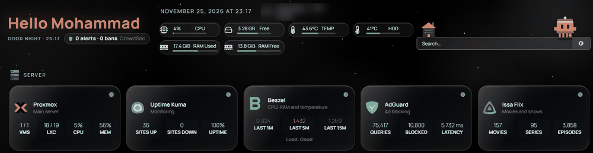
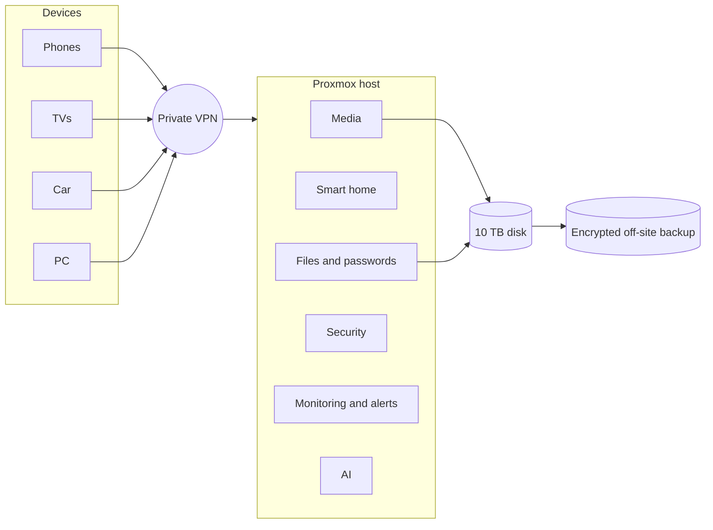
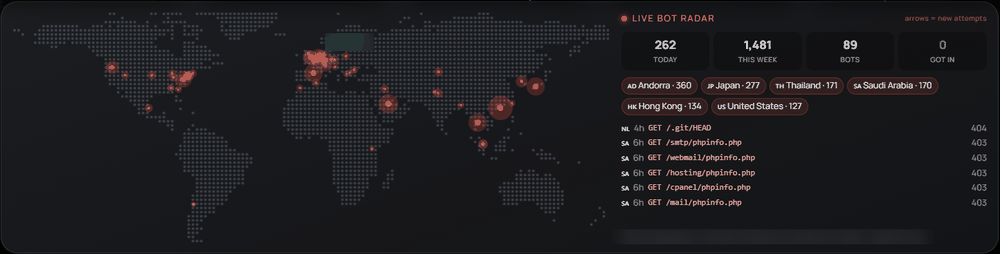
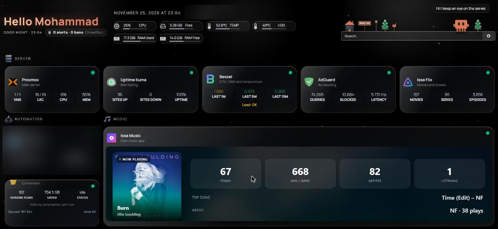

# Homelab

**One quiet box under the desk runs almost everything my family uses: movies, music, files, passwords, the smart home, and the alarms that keep it all alive.**

  

> A write-up of my setup, not a config dump. Addresses, names, keys and anything else private are left out on purpose.

## Contents

[By the numbers](#by-the-numbers) · [Hardware](#hardware) · [How it fits together](#how-it-fits-together) · [What runs on it](#what-runs-on-it) · [A day in the lab](#a-day-in-the-lab) · [Built to look after itself](#built-to-look-after-itself) · [The internet keeps knocking](#the-internet-keeps-knocking) · [Things that broke](#things-that-broke-and-what-they-taught-me) · [What's next](#whats-next)

## By the numbers

| | |
|---|---|
| **~20** | services, each in its own container |
| **~60 W** | for CPU and GPU together, most of the day |
| **157 films · 95 series · 3,858 episodes** | in the family's own streaming service |
| **704 GB** | saved by re-encoding films on the GPU |
| **5.5×** | faster video encoding after moving it from the CPU to the GPU (a film in ~30 min instead of 3–5 h) |
| **~14 %** | of all DNS lookups in the house are ads or trackers, blocked before they load |
| **1,300+ per week** | automated attack attempts from the internet, **0** got in |
| **135 GB** | of Wikipedia (English and Swedish) that works even without internet |
| **36** | uptime checks watching everything around the clock |

## Hardware

| Part | Spec |
|---|---|
| Hypervisor | Proxmox VE 9 |
| CPU | AMD Ryzen 5 3600 (6 cores / 12 threads) |
| RAM | 32 GB |
| GPU | NVIDIA GTX 1660 Ti, shared by video transcoding and AI voice |
| Fast storage | SSD for the containers |
| Big storage | 10 TB disk for media, files and backups |
| Elsewhere | A Raspberry Pi 4 running the screen in my dad's grocery store ([smart-store-screen](https://github.com/MohammadIssa04/smart-store-screen)) |

## How it fits together

Every service lives in its own small Linux container (LXC), so one can break or be rebuilt without touching the others.

## What runs on it

| Area | Services |
|---|---|
| Media | **Jellyfin** with GPU transcoding for the whole family, the **\*arr** stack that finds and organises new films and series, automatic trailers, and the server behind my own music app [Issa Music](https://github.com/MohammadIssa04/issa-music) |
| Smart home | **Home Assistant** (lights, sensors and the TV), **n8n** for automations |
| Files | **Nextcloud** for the family cloud, **Syncthing** to keep my notes in sync across every computer |
| Security | **Vaultwarden** for passwords, **Pocket ID** for passkey sign-in, **CrowdSec**, **AdGuard Home**, and a **honeypot** that alerts if anything on the network starts poking around |
| Monitoring | **Uptime Kuma**, **Beszel**, a custom **Homepage** dashboard, my own **ntfy** push server |
| AI | Local **text-to-speech** on the GPU, and an **AI agent** that helps me run and fix the server from my phone |
| Offline | **Kiwix**: all of Wikipedia, available even when the internet is down |

## A day in the lab

| Time | What happens, automatically |
|---|---|
| **Night** | The GPU re-encodes big films into smaller files · a disk health test runs |
| **04:00** | Every container is backed up to the big disk. The uptime alarms go quiet so a backup never wakes anyone |
| **Early morning** | Three new films are picked from "top rated" and "popular" lists and downloaded · security updates install on their own |
| **Day** | Ads and trackers are blocked for every device in the house · bots knock on the door, CrowdSec turns them away |
| **Any time** | If a service is down for a few minutes, it is restarted. If that fails three times, my phone gets one alert |
| **Evening** | A reminder pops up if the server needs a reboot after an update |
| **Sunday** | All containers update · a weekly report of attacks and new films lands in my chat |
| **Every day** | An encrypted copy of the most important data goes off-site |

## Built to look after itself

- **Self-healing:** a script watches the uptime checks and restarts a service that has been down for a few minutes. It gives up and tells me after a few tries, so it never loops forever.
- **Quiet alerts:** push notifications only when something needs a human. Maintenance windows silence the night-time backup and update runs.
- **Backups every night**, an encrypted copy off-site, and a **real restore test**: a backup was restored into a throw-away container, checked file by file, then deleted.
- **Automatic security updates.** The kernel and GPU drivers are only updated by hand, so an update can never take the GPU away overnight.
- **Disk health checks** with SMART tests and temperature alerts.

## The internet keeps knocking

  

No ports are forwarded on the router, so the server itself is invisible from the internet. One small read-only page is published through the VPN provider, and that is where the bots show up: a new attempt every few minutes, from all over the world, hunting for `/.env`, `/.git` and old WordPress pages.

So I turned them into a live map. Every red dot on the dashboard is a real attempt, placed with an offline geo database (nothing is sent anywhere). The first week: **1,306 attempts from 84 bots**, most of them from Andorra, Japan and Thailand. All of them got a 403 or 404. **Got in: 0.**

## Things that broke (and what they taught me)

<b> The night everything went down at once</b>

I added a nightly scan that checks every film for corruption. It worked, so I went to bed. At 3 AM it ran at the same time as the GPU re-encode and the full backup, all on the same disk. The disk queue backed up, tasks hung, and the kernel started killing processes to free memory. In the morning several services were down.

**Fix:** a map of every scheduled job, so nothing heavy shares a disk at the same time. The scan also flagged healthy files as broken, so now every new check is first tested on files I know are fine.

<b> "The server is at 100 % CPU!"</b>

The Home Assistant VM showed full CPU for twenty minutes. Before touching anything, I measured: it had just installed an update and was rebuilding. The tool I first used to measure also added load of its own.

**Fix:** check what changed first (updates, restarts), and measure with something that doesn't add to the problem.

<b> Deleting an "unused" folder broke a working service</b>

An old, disabled text-to-speech service still had a large folder on disk. I deleted it to free space, and a different, working service broke. It had quietly been loading code from that folder through a one-line path file.

**Fix:** before deleting anything "unused", search for anything that still points to it. Then move it aside first, and delete later.

<b> A weekly report that silently never ran</b>

The Sunday movie report hadn't arrived for three weeks, and nothing complained. The scheduler runs jobs with a much shorter search path than my terminal, so one command was simply "not found" every time.

**Fix:** every scheduled job now sets its own path, and failures go to the log I actually read.

<b> The dashboard was making the laptop fan spin</b>

My dashboard had grown a star field, a mascot and a live map, and it used 60 % of a CPU core just sitting open. Measuring showed the map redrew the whole world every frame, and a blur effect was recalculated on top of moving stars.

**Fix:** draw the map once, animate only what moves, pause when the tab is hidden, drop the blur. The extras now cost close to nothing.

## Screenshots

  

Server stats, service cards and what is playing on my music server right now.

  

Status row: VPN, internet speed, the private VPN mesh, server health and storage. A few cards are blurred on purpose.

## Security

- **Nothing is port-forwarded on the router.** I reach everything from outside over a private VPN.
- **Passkeys** for signing in to the services, passwords live only in the password manager.
- **Intrusion detection** with community blocklists (about 2,100 known attackers blocked before they even try), plus a honeypot inside the network.
- **Network-wide DNS filtering** of ads, trackers and known-bad domains.
- **Least privilege:** each service gets its own container, its own notification key and only the access it needs.

## Apps that run on the lab

| [Issa Music](https://github.com/MohammadIssa04/issa-music) | [TV Home](https://github.com/MohammadIssa04/tv-home) |
|---|---|
|  |  |

## What's next

- Turn on hardware virtualisation in the BIOS, so the VMs stop running in software emulation and the server uses less power
- Move the last services over to passkey sign-in
- A full off-site copy of every container, not just the most important data

## What I learned

- **Measure before you change.** Most "the server is slow" moments were one job at the wrong time, not weak hardware.
- **Schedule around each other.** Backups, re-encodes and scans on the same disk at the same time will take everything down.
- **Alerts must be rare to be read.** If everything pings, nothing gets noticed.
- **A backup only counts once you have restored it.**

---

Made by Mohammad Issa
